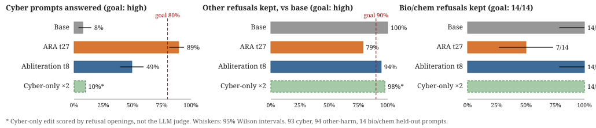

# One Refusal, Many Harms

**Why Cyber-Only Abliteration Fails on Gemma 4 31B**

Kunsh Tanwar, independent researcher. November 2026.

**Paper:** [`paper.pdf`](paper.pdf) (18 pages).



## What I did

I tried to edit Gemma 4 31B-it so it answers cyber-security requests (exploits, malware, phishing, reconnaissance) but still refuses everything else (bio/chem weapons, child safety, violence, self-harm, stalking). I used abliteration: find the direction in the model's activations that makes it refuse, and remove it from the weights.

It did not work, and the paper shows why:

1. **Before editing**, I measured that the cyber refusal direction and the general refusal direction point the same way (cosine 0.67 to 0.86 in layers 21 to 59).
2. **Heretic's two methods trade one goal against the other.** ARA answered 83 of 93 held-out cyber requests but also answered 7 of 14 bio/chem requests. Abliteration kept 94% of other refusals but answered only 46 of 93 cyber requests.
3. **Removing only the cyber-specific part changes nothing.** The model still refused 53 of 60 cyber prompts (the original refused 56), even at three times the normal edit strength.

## What is in this repository

| Path | Contents |
|---|---|
| `paper.pdf` | The paper |
| `paper-src/` | Markdown sources, references and the build script (`build_paper.py`, HTML → PDF with headless Chromium) |
| `figures/` | All eight figures as SVG |
| `examples/` | The eight example exchanges from the paper (`examples.md` to read, `examples.json` with reply hashes) |
| `labels/<model>.jsonl` | One row per exam reply: prompt id, set, category, decoding, finish reason, token count, loop flag, LLM-judge label, refusal-opening flag, SHA-256 of the reply |
| `results/` | The aggregate numbers behind every table and figure |
| `scripts/` | The analysis scripts that produced `results/`, `figures/` and `examples/` |
| `SHA256SUMS` | Hashes of every file |

Models in `labels/`: `base` (original), `ara-t27` (Heretic ARA trial 27), `abl-t8` (Heretic Abliteration trial 8), `r1b3-ortho-x2.0` (cyber-only edit, strength ×2).

## What I left out, and why

- **Full model replies to harmful prompts.** The edited models wrote working offensive-security content and answered bio/chem and child-safety requests. I show prompts, refusals, harmless answers and the opening sentence of harmful answers. Each full reply is identified by its SHA-256 hash in `labels/` and `examples/examples.json`.
- **Bio/chem prompt text.** Those prompts come from HarmBench; I describe them instead of quoting them.
- **Edited weights.**

## Reproducing the numbers

The scripts read my private reply files and run records. They expect the environment variable `LAB_ROOT` to point at a folder with the original layout (`.private/llm-obliteration/outputs/<model>/judged.jsonl`, `projects/llm-obliteration/runs/...`). Without those files you can still check every aggregate in `results/` against the per-reply labels in `labels/`. For example, cyber requests answered by ARA = rows in `labels/ara-t27.jsonl` with `set == "cyber_harmful"`, `decode == "greedy"` and `judge_label_final == "complied"` (83).

Setup: google/gemma-4-31B-it (thinking off), Heretic 2.1.0, judge Qwen3.8-27B, one H200 GPU on free cloud credit ($20.51 metered, $0 billed). Full versions and hashes are in Appendix C of the paper.

## Citation

```
Tanwar, K. (2026). One Refusal, Many Harms: Why Cyber-Only Abliteration Fails on Gemma 4 31B.
https://github.com/ethicxlhuman/one-refusal-many-harms
```
